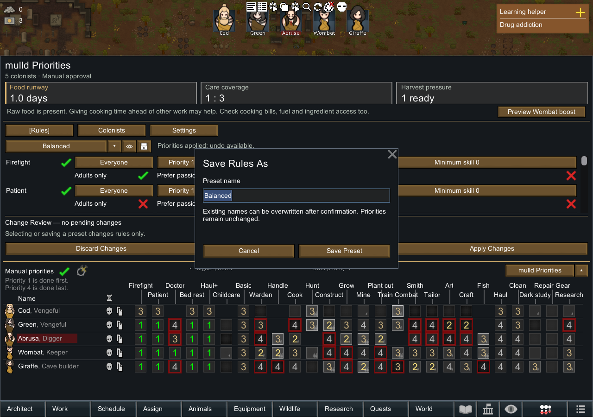

# mulld Priorities

**Colony needs, work rules, and reviewable priority changes—all inside RimWorld's Work tab.**

`mulldPriorities` is a mod for **RimWorld 1.7 / Waylith**. See what your colony needs, choose how work should be staffed, and preview the proposed assignments before applying them.

**Manual approval by default. Daily automation and performance diagnostics are opt-in.**

## What it does

- **Needs first:** food runway, care coverage and harvest pressure stay visible above the work grid.
- **Useful assignments:** primary workers, capable backups and spare-time work, with essential roles considered first.
- **Readable review:** changed cells show the proposed number at full size. Select a gold cell to inspect its current → proposed value.
- **Named presets:** start with Balanced, Clean, Harvest or Haul, then save your own rules. Existing names can be overwritten after confirmation.
- **Player control:** exclusions, assignment locks, temporary need boosts, draft discard and protected undo.
- **Native integration:** the original Work table and modded work columns remain available. Collapse the extension using the segmented control above the grid.

## Requirements

| Requirement | Supported configuration |
| --- | --- |
| RimWorld | 1.7 / Waylith; validated on 1.7.5005 |
| Harmony | Required; load before mulld Priorities |
| Priority scale | Off / 1 / 2 / 3 / 4 |

## Install

1. Put the mod in `RimWorld/Mods/mulldPriorities`. That folder should contain `About`, `Assemblies`, `Defs`, `Patches` and `Textures`.
2. Enable **Harmony** and **mulld Priorities** in the Mods menu.
3. Restart RimWorld and open **Work** on a colony map.

Existing work assignments stay unchanged when the mod is enabled. The package ID remains `mulld.priorities` so existing saves retain their settings. Older local installations using the misspelled folder name are migrated by the installer; do not keep two copies enabled.

## Configure → preview → apply

1. **Choose a preset** using its centered name or the adjacent chevron.
2. **Adjust Rules** as needed. The Colonists tab controls exclusions and locks; Settings contains targets, primary-job limits and optional daily assignment.
3. Click the **eye** to **Preview Changes**. Gold outlines mark changed cells; their numbers are proposed priorities.
4. Select a changed cell to see its current and proposed values in the review row.
5. Click **Apply N Changes**. Use **Discard Changes** to clear the draft, or **Undo Last Apply** to restore eligible assignments from the last batch.

If numbered priorities are disabled, applying requires explicit consent to enable them for the save. Drafts are checked again before application so later edits, protections and unavailable colonists are not silently overwritten.

## Presets and custom rules

| Preset | Behavior |
| --- | --- |
| **Balanced** | Distributes skilled primary work, covers essentials first, and retains backup and spare-time assignments. |
| **Clean** | Cleaning at priority 1 for every available, eligible managed colonist. |
| **Harvest** | Growing at priority 1 for every available, eligible managed colonist. |
| **Haul** | Hauling at priority 1 for every available, eligible managed colonist. |

Focus jobs can exceed the primary-job limit, while locks, exclusions, incapabilities and active boosts remain protected. Focus rules stay active until changed, so other work may wait.

Click the **disk** to **Save Rules As**. Give the rule set a custom name, or confirm overwrite to replace an existing preset. Built-in names can have local overrides; **Factory defaults…** still provides the original rules.

Saving and loading presets changes rules, not live work assignments. Presets are shared across colonies in the same save profile and exclude colonist locks, exclusions, temporary boosts, food targets and the daily-automation switch.

See custom preset saving and overwrite confirmation

## Performance

Diagnostics are **off by default**. Enable them under **Options → Mod Settings → mulld Priorities** to inspect operation counts, average/worst elapsed time and managed allocation bytes. Counters have fixed storage; there is no background sampler or growing history.

The 0.4.0 benchmark used **100 spawned colonists, 39,747 map things, 4,001 haulables, 2,000 ready crops and 99 loaded mod entries**:

| Measurement | Result |
| --- | ---: |
| Priority planning | **1.43 ms median**, 64 warmed samples |
| Review extension drawing | **0.15 ms average**, 120 Repaint samples |

These are paused-simulation operation measurements, not overall FPS/TPS improvements or per-mod CPU usage. Native work-table drawing is excluded from the extension measurement. [Read the test methodology and results](Tests/ProposedNumbers.md).

## Compatibility and limits

- Validated with the tested **99-entry mod configuration**, including assignment paths for **26 visible work types**.
- AutoPriorities' active per-map timer pauses mulld's daily assignment. Manual preview/apply stays available; mulld does not change the other mod's settings.
- Hunting, dark study and unfamiliar mod work remain manual in the built-in presets.
- Needs indicators estimate staffing pressure. Bills, fuel, tools, areas, storage and access can still prevent jobs from running.
- Multiplayer, expanded priority scales and every race/work-manager combination are not validated.

The mod is an independent implementation; no AutoPriorities code or assets are included.

## Development

The repository, local mod folder and release-package prefix are **`mulldPriorities`**. The in-game name is **mulld Priorities**.

Build scripts, isolated testing instructions, diagnostics details and preset formats are documented in [the development guide](docs/DEVELOPMENT.md). Game and Harmony binaries are referenced locally and are not redistributed.

- [Changelog](CHANGELOG.md)
- [Current functional and compatibility results](Tests/ProposedNumbers.md)
- [Earlier optimization benchmark](Tests/Performance.md)
