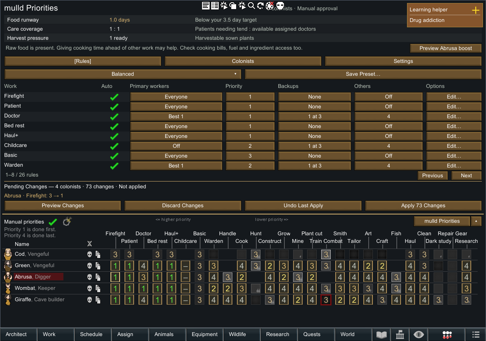
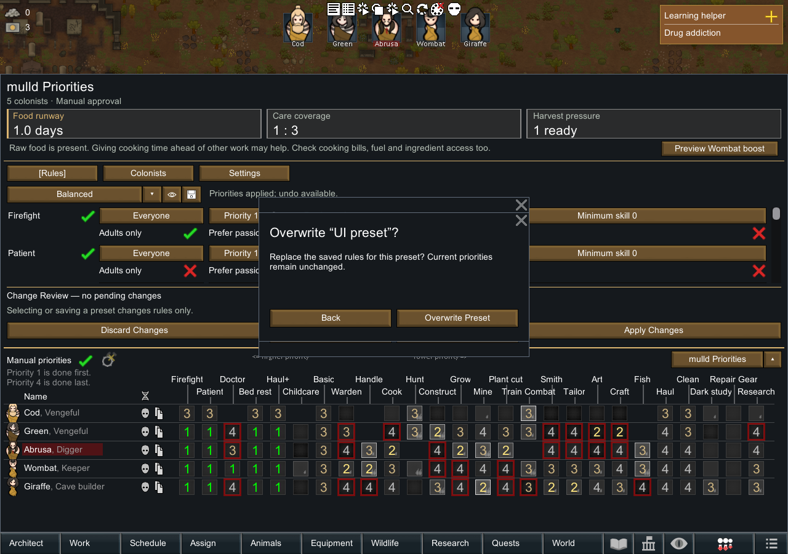

# mulld Priorities

**See what your colony needs. Give your pawns useful work. Review before applying.**

A RimWorld 1.7 mod built into the Work tab.

## Features

- **Colony needs:** food runway, care coverage and harvest pressure above the work grid.
- **Balanced assignments:** essential jobs covered, with primary workers, backups and spare-time work.
- **Presets:** Balanced, Clean, Harvest and Haul—or save and overwrite your own.
- **Clear previews:** proposed numbers highlighted directly in the grid. Nothing changes until you apply.
- **Your control:** colonist exclusions, locked assignments, discard and undo.
- **Lightweight:** optional daily automation and performance diagnostics, both off by default.

## Install

Requires **RimWorld 1.7 / Waylith** and **Harmony**. Uses the standard Off / 1–4 priorities.

1. Place the mod in `RimWorld/Mods/mulldPriorities`.
2. Enable Harmony and **mulld Priorities**, then restart RimWorld.
3. Open **Work** and expand **mulld Priorities** above the grid.

## Use

Choose a preset → adjust **Rules** → click the **eye** to **Preview Changes** → **Apply**.

Click a highlighted cell to compare its current and proposed priority. Use the **disk** to save your rules as a named preset.

Custom presets

## Compatibility

Tested with 99 loaded mod entries and 26 work types. Locks and exclusions are respected; unfamiliar mod work stays manual in built-in presets. Staffing coverage still depends on bills, access and available workers. Expanded priority scales and multiplayer are untested.

[Build and development guide](docs/DEVELOPMENT.md) · [Test results](Tests/ProposedNumbers.md) · [Changelog](CHANGELOG.md)
